<p align="center">
  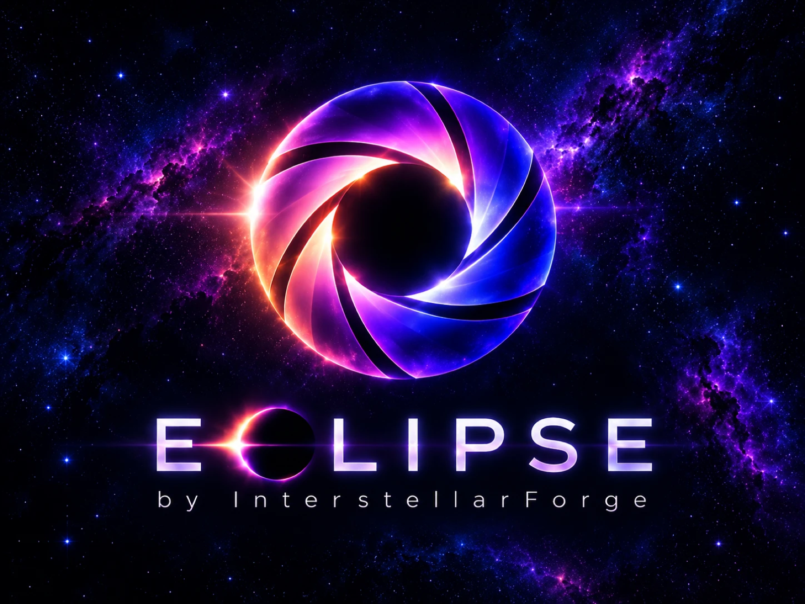
</p>

<p align="center">
  <b>Ideas. Motion. Stories. Beyond.</b><br>
  <b>An AI video editor where the assistant does the editing.</b><br>
  Tell it what film you want. It watches your clips, plans the cut, and builds the real, editable project.<br>
  Free and local, for macOS and Android.
</p>

<p align="center">
  <a href="https://github.com/interstellarforge/eclipse/releases"></a>
  
  
  
  
</p>

---

## The idea

Most video editors are either a timeline you push around by hand, or a "make me a video" button that gives you no control. Eclipse puts an assistant in front of a complete editor, so you get the speed of one and the control of the other:

- **The assistant first.** Describe the film; it does the editing (see above).
- **A complete manual editor underneath.** Multi-track timeline, trim, split, snap, keyframes, 47 transitions, 34 effects, 19 overlays, 27 title styles, 18 colour looks, music, voice-over, export.
- **One shared set of controls.** Every edit, by you or by the assistant, is the same undoable command. Nothing the assistant does is hidden or locked in; you can step through it with undo, or take over mid-edit.
- **Local first.** Your footage stays on your machine. An **Offline mode** keeps clips, frames and audio away from any AI service entirely: the assistant gets only the start and end times *you* mark.
- **Native, not a webview.** Swift (AVFoundation, Core Image) on macOS, Kotlin and Jetpack Compose (Media3) on Android. No FFmpeg, no subscription, no account.

<p align="center">
  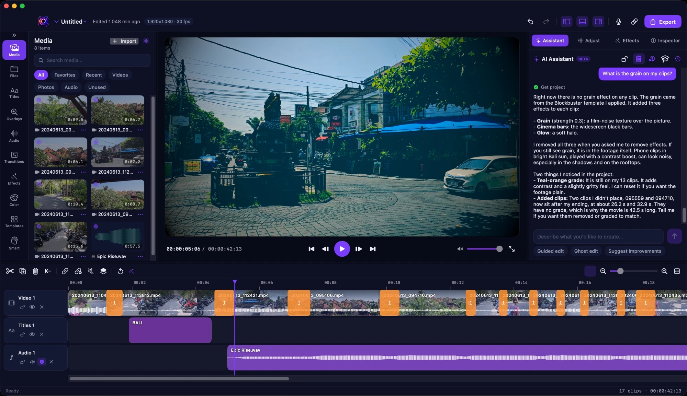
</p>

## The AI Assistant: the heart of Eclipse

The assistant is the main way to use Eclipse. You describe the film in plain words, and it does the editing: it watches your footage, decides which moments matter, cuts, grades, adds titles, joins, effects, overlays and music, then reviews its own work and tells you what it chose and why. Everything lands on the normal timeline, so you can undo any step or take over at any point.

<p align="center">
  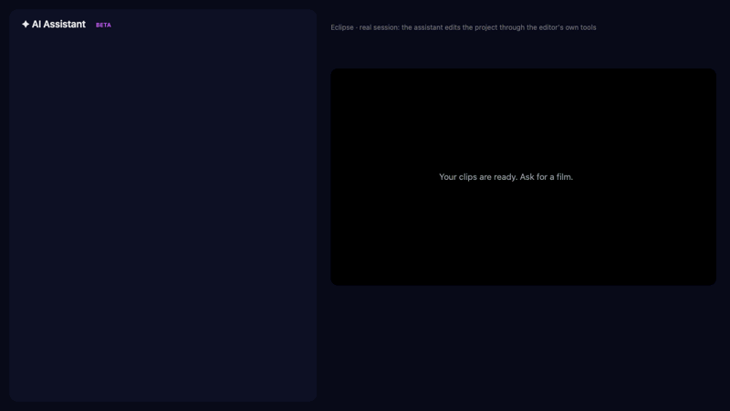<br>
  <sub>A real, unedited session (<a href="docs/media/assistant-demo.mp4">full-quality video</a>): one request, four clips, a finished 25-second film. The tool rows are the assistant's actual calls; the preview shows what it built.</sub>
</p>

> **Request:** "Make a 25 second film from my four clips (sunset, ocean, city, forest). Open with a title, give each scene its own colour look, join them with two different transitions, add a gentle overlay on the last scene and a soft music bed. Keep it calm and tasteful."
>
> **What happened:** the assistant read its director skills, asked the editor for creative treatments, *watched* each clip, planned a "slow burn" film, and built it in one edit (its first attempt was rejected, so it revised the plan). Then it watched the timeline to check the result and replied with a summary of every choice: a title, a different grade per scene, a crossfade and a blur-fade (it kept one hard cut on purpose), fireflies over the last scene and a music bed. The session cost about 11 US cents of Claude usage.
>
> [Watch the film it made](docs/media/assistant-result.mp4) · [Read the full session](docs/media/assistant-session.json)

<p align="center">
  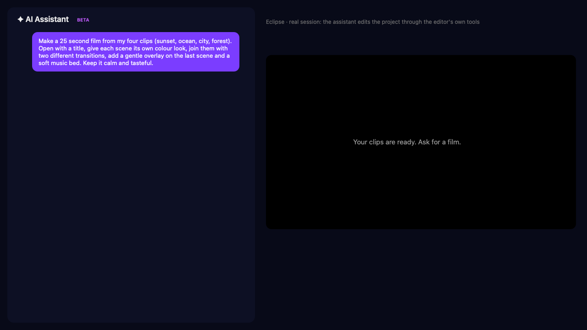
  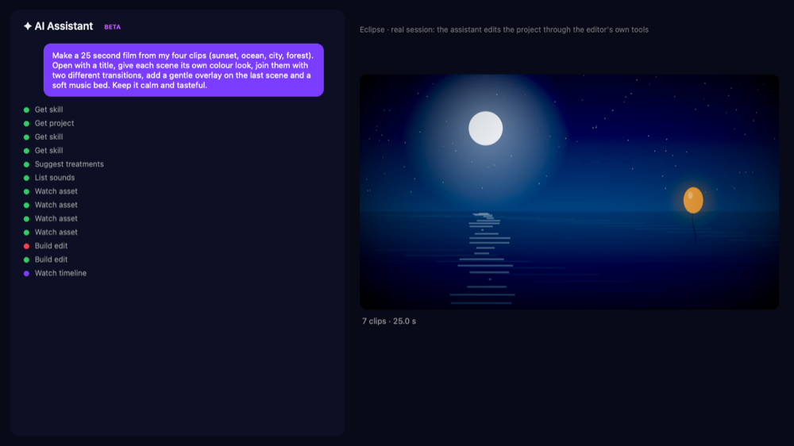
  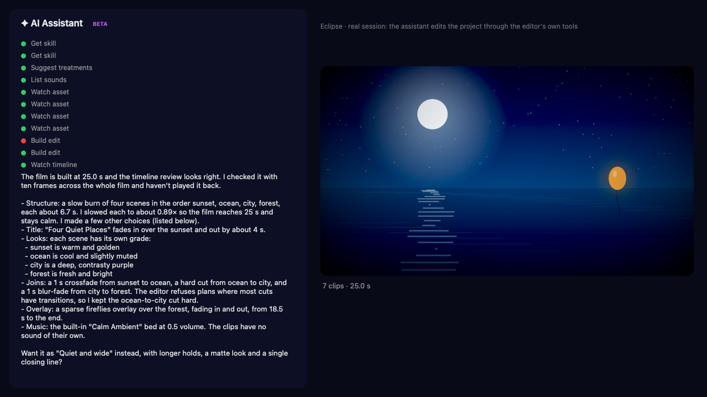
</p>

### Why it is different from a "make me a video" button

- **It edits the real project.** There is no render-then-hope step. The assistant calls the same 70+ editing tools the interface uses (add and trim clips, transitions, looks, effects, overlays, titles, keyframes, speed, music, export), so the result is a normal Eclipse project you can keep editing by hand.
- **It looks at your footage.** Tools to inspect a clip, watch a clip as frames, watch the finished timeline and grab a frame let it judge what is actually in the shots instead of guessing from file names.
- **It directs, not just assembles.** 18 built-in director skills (pacing, beat-synced cuts, trailers, reels, documentary, wedding and more) are loaded when the job calls for them.
- **It avoids lazy defaults.** A creativity guard stops the usual crutches (film grain, cinema bars and glow on every edit, the same arc every time). The assistant has to pick a specific treatment and stay inside a restraint budget, and the editor refuses plans that stack the usual tricks.
- **It asks instead of guessing.** It can put a question to you with options, or let you watch a clip and mark *start here / end here* for the moments you want.
- **You stay in control.** Every edit is undoable. Ghost edit lets it work on a copy of the timeline that you accept or reject.

### Modes for different jobs

| Mode | What it does |
|---|---|
| **Just ask** | One request, one finished edit. Specific changes ("add a crossfade here", "set the music to 40%") are done directly with no questions. |
| **Guided edit** | The assistant interviews you one question at a time, then builds the film from your answers. |
| **Script mode** (Medium, Advanced, Director) | It analyses your clips, drafts a script as beats, and waits for you to edit and approve the script before it cuts anything. |
| **Ghost edit** | Changes a named part of a *copy* of your timeline. You compare, then accept or discard. |
| **Suggest improvements** | Reviews your current edit and proposes concrete fixes without changing anything. |
| **Offline mode** | Nothing from your footage goes to an AI service: the analysis tools that send pictures or audio are hidden, and the assistant gets only the start and end times you mark. `scripts/offline-watch.sh` is a read-only monitor that shows no image reached a transcript. |

### Bring your own agent

- **macOS:** uses the Claude Code you already have installed and signed in to (no API key handled by Eclipse). Codex and OpenCode are supported experimentally.
- **Android:** the assistant calls the Claude API directly with your own API key, using the same tools.
- **Workspace folders:** open a folder and the assistant can browse and analyse what is inside, with file counts and sizes, and import only what it needs.

## What you can do by hand

### Edit

| | |
|---|---|
| **Timeline** | Any number of video, audio and title tracks. Drag, trim, split, ripple delete, snap to cuts and the playhead, zoom, group clips, lock, hide and mute tracks. Filmstrips and waveforms on every clip. |
| **Keyframes** | Animate opacity, size, position and rotation. Splitting a clip keeps the animation continuous. |
| **Speed** | Constant speed, plus smooth speed ramps (slow-motion and fast curves) with presets. |
| **Audio** | Volume, fades, automatic ducking of music under speech, a built-in music library of 47 generated songs (tempo known, so cuts can land on the beat), voice-over recording, detach audio from video. |
| **Media** | Import video, photos and audio. Small/large previews, list and detail views, search, favourites, unused filter. A Finder-style **Files** tab with preview, multi-select and drag to import. |
| **Projects** | Undo/redo everywhere, autosave and crash recovery, save/open, canvas presets (16:9, 9:16, 1:1, 4:5). |
| **Export** | H.264 + AAC MP4. Choose name, size (720p to 4K), frame rate and quality. Open or share the result straight away. |

### Make it look good

Every item below is a real tile in the app: tap it, or drag it onto the timeline.

#### Overlays: 19 drawn layers above your picture

Confetti, snowfall, rain, sparkles, fireflies, fireworks, bokeh, sun rays, floating hearts, rising embers, film dust, stars, petals, bubbles, leaves, smoke, streaks, digital rain and a photo frame.

<p align="center"></p>

#### Transitions: 47 styles

Crossfade, dips, wipes, slides, whips, zoom, spin, iris, barn doors, blinds, clock, pixelate, glitch, ripple, page curl, cube spin, film burn, TV static and more. Drag one onto the join between two clips.

<p align="center"></p>

#### Effects: 34 camera and picture effects

Slow zoom, pans, camera shake, pulse, light leak, VHS, chromatic aberration, glitch, kaleidoscope, fisheye, neon edges, tilt-shift, vignette, halftone, strobe and more. Strength is adjustable per clip.

<p align="center"></p>

#### Colour looks: 18 grades

Teal and orange, golden hour, noir, cyberpunk, vintage film, pastel, cold steel, bleach bypass and more, applied to one clip or the whole movie.

<p align="center"></p>

#### Titles: 27 styles

Lower thirds, movie titles, neon, typewriter, gold, quote, chapter cards, news bar, handwritten sign-off and more, with entrance animations.

<p align="center">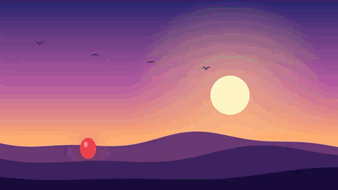</p>

Plus **35 one-tap templates** (a grade, effects, joins, titles and an overlay in one go) from Blockbuster and Noir to Wedding and Reels.

> The clips above are rendered by Eclipse itself from four generated sample scenes: `swift run ReadmeMedia docs/media` recreates them and their GIFs from the real editor code. Full-quality MP4s are next to each GIF in [`docs/media`](docs/media).

## Eclipse for Android

The same editor on your phone, written natively (Kotlin, Jetpack Compose, Media3). Project files use the same JSON fields as the Mac app.

<p align="center">
  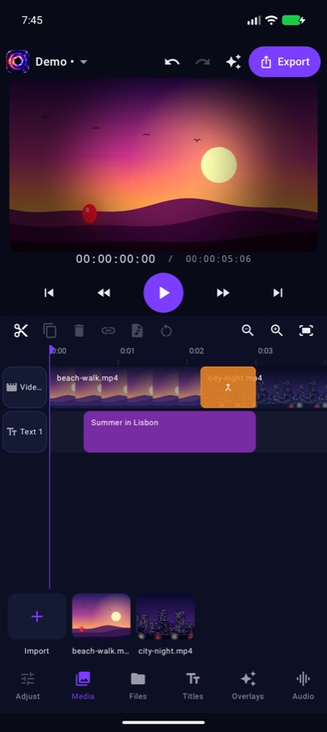
  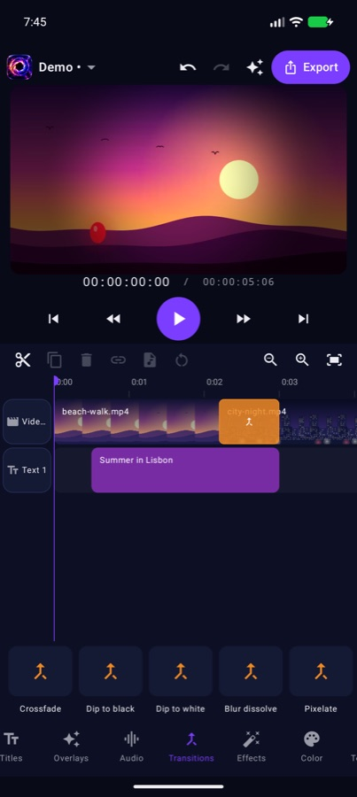
  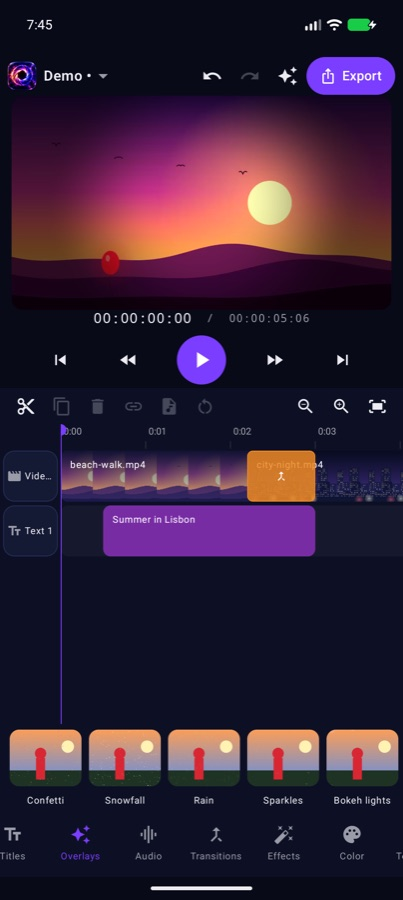
  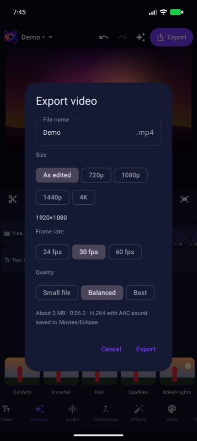
</p>

- **One-row tray.** Transitions, effects, looks, overlays, titles and your clips sit in a single row above the navigation. Tap to apply, or press and hold and **drag onto the timeline**: a transition onto a join, an effect onto a clip, an overlay or title to a moment.
- **Rendered transitions.** Transitions are rendered once and played on a single video lane, so previews and exports work on phones that cannot blend two live video layers.
- **Export settings** with name, size, frame rate and quality, then Open or Share.
- **Updates without the Play Store.** The app checks GitHub Releases on launch and offers new versions. Android always asks you to confirm the install.
- **Diagnostics** (project menu) shows player state and an event log you can share when something misbehaves.

See [`android/README.md`](android/README.md) for build steps and what is not ported yet.

## Install

### macOS (15 or later)

```bash
git clone git@github.com:interstellarforge/eclipse.git && cd eclipse
scripts/bundle.sh          # builds dist/Eclipse.app (ad-hoc signed, runs on this Mac)
scripts/bundle.sh dmg      # also makes dist/Eclipse.dmg
```

Needs the Swift toolchain (Xcode or Command Line Tools). Sharing the app with other Macs needs a Developer ID signature and notarisation.

### Android (8.0 or later)

Download the latest `.apk` from [Releases](https://github.com/interstellarforge/eclipse/releases) and open it. Android will ask you to allow installs from your browser or file manager once. Later updates arrive inside the app.

To build it yourself: JDK 21, Android SDK 36, then `cd android && ./gradlew assembleDebug`.

## How it is built

```
SwiftUI / AppKit  ─┐                               Compose UI (Android)
                   ▼                                       ▼
         MovieCore: Project model + Command layer + undo  (same model on both)
                   │
     ┌─────────────┼──────────────────┐
     ▼             ▼                  ▼
  Import &     Composition       Export
  analysis     builder           H.264 + AAC
               AVFoundation +    Media3 Transformer
               Core Image        + GL shaders
```

- **One rule:** the project is a value type, and every change is a `Command` applied with undo. The UI, the assistant (over a local, token-protected MCP server on macOS) and the templates all go through it.
- **Preview equals export.** The same composition feeds the player and the exporter.
- **macOS:** Swift Package (`MovieCore` library, `MovieMaker` app). Two check suites, `swift run NewChecks` (fast) and `swift run CoreChecks` (slow, legacy).
- **Android:** `android/`, Kotlin 2.2, Media3 1.11, 26 JVM unit tests (`./gradlew testDebugUnitTest`).
- **Catalogues stay in sync:** `scripts/gen-android-catalog.py` and `scripts/gen-android-content.py` generate the Android lists of transitions, effects, overlays, titles, looks, templates, skills and songs from the Swift source.

## Brand

<p align="center">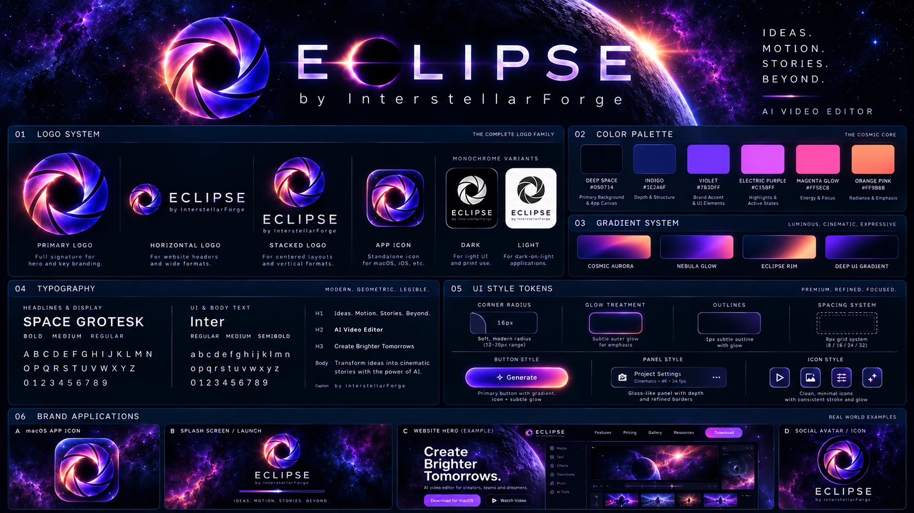</p>

The icon and logo sources are in [`docs/brand`](docs/brand). Regenerate the app icons from `Resources/Brand/icon.png` with `swift scripts/make-icon.swift`.

## Status

Eclipse is a young project. Be aware of:

- Android preview and export are tested on an emulator and one phone; very long projects (many clips) may export slowly or stall on some devices.
- On Android, each of the 47 transitions plays as the nearest of five looks (dissolve, dip, push, zoom, spin); macOS draws all 47 distinctly.
- Not on Android yet: sound-effect library, auto movie, captions/transcription, silence removal, match cuts, smart reframe.
- The Mac app is ad-hoc signed.

## Credits

Made by **InterstellarForge**. Built with Swift, Kotlin, AVFoundation, Core Image, Jetpack Compose and AndroidX Media3.
